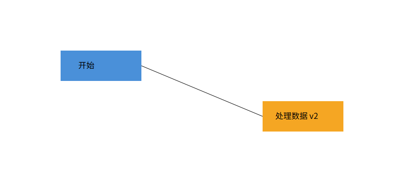

# Lab1 SVG CLI 编辑器

个人 Lab1，TypeScript + 面向对象实现，使用 AI 协作并记录架构与开发过程。

仓库：https://github.com/SharkerSwag/lab1-svg-editor

**当前状态：Phase 1 功能验收通过，本轮 81 项测试通过，包含 1,200 步固定种子的混合操作检查。** `main` 包含复核后的修复。已有 `final` 是过早标记的旧版本，暂保留作对照，不代表当前代码的正式交付确认。`box` 和动态插件不属于本阶段。

想弄清终端操作和图片之间的关系，可先照着 [十分钟动手验收](doc/动手验收.md) 操作，覆盖十九条命令，并附真实浏览器截图与架构阅读路线。

## 先看图片

在项目目录的普通终端中运行 `npm ci`，再运行 `npm run demo:svg`，将生成的 `output/flowchart.svg` 拖进浏览器。以下截图来自浏览器加载程序实际导出的 SVG：



演示先画出两个节点，再将右侧节点下移、修改文字并调整连线端点，最后保存、读取。`output/flowchart-before.svg` 是修改前，`output/flowchart.svg` 是修改后。保存后刷新浏览器即可看到变化。

## 本地运行

需要 Node.js 24 或更新版本。

```powershell
npm ci
npm run cli
```

输入 `help` 查看全部命令。Windows 下按 Ctrl+Z 再回车发送 EOF 退出，或按 Ctrl+C 退出。只有交互终端显示 `svg> ` 提示符；脚本输入不显示提示符。更新代码后需退出旧 CLI 并重新运行。

可以在 CLI 内逐行输入（不要复制 `svg>` 提示符）：

```text
init 800 600
create g node1
create rect start 120 100 160 60 #4a90d9 in node1
create text label 155 135 "开始" in node1
tree
show start
undo
tree
redo
tree
save "我的图.svg"
```

`undo` 撤销刚创建的文字，`redo` 将其恢复；最后的 save 导出文件，可直接在浏览器打开。g 是不可见的分组，tree 是结构目录。创建失败不占用 id、不改变文档和历史。成功 `init/read/save` 或 `canvas w h` 清空历史并禁止撤销重做，直到下一次成功编辑；只查询 `canvas` 不影响历史。

在工程目录的普通终端中（不是 `svg>` 内）运行完整的两节点流程图创建演示：

```powershell
npm run demo
```

演示脚本位于 [examples/creation.txt](examples/creation.txt)，包含中文标签、嵌套分组和撤销重做。

导出真正的图片文件：

```powershell
npm run demo:svg
```

随后把工程目录的 `output/flowchart.svg` 拖进浏览器查看。此文件由本程序的 `save` 生成。也可以在 `svg>` 中执行 `save "我的图.svg"`。read 后的无参数 save 写回读入路径；显式保存到另一文件只导出副本，不改变已绑定的默认路径。init 后首次成功 save 建立默认路径。成功保存设置历史屏障，失败不改变历史和关联路径。`output/` 是生成目录，不提交 Git。

```powershell
npm run typecheck
npm test
npm run demo:full
```

项目 `.npmrc` 使用 npm 官方 registry，避免本机旧镜像地址影响安装；不修改用户全局 npm 配置。

`demo:full` 回放作业第 6 节完整会话和案例 A，其中祖孙冲突分组与保存后 undo 的两条错误是题目预期行为。十九条命令均已注册并列在 help 中。应用运行不需要 Java，文档里的 PlantUML 图已预先生成。

外部 SVG 导入范围与边界见 [作业文档](doc/README.md)。本程序支持题目要求的六种基本元素，不是通用 SVG 浏览器；遇到未支持的格式会明确报错。

## 作业文档与提交

- [架构方案、过程记录、自查与质量保证](doc/README.md)
- [功能验收清单与时间安排](doc/验收清单.md)
- [验证记录与测试覆盖](doc/verification.md)
- [二次独立审查与实际修复](doc/review-2026-10-19.md)

截至课程平台显示的 2026-10-31 23:59，需要推送最终代码和 `final` 标签，并把包含仓库地址的 `doc/README.md` 以文件名 `README.md` 上传课程平台。平台时区以课程设置为准。课程平台上传及提交状态核对需由本人完成；页面可访问到 11 月 30 日不代表作业延期。
