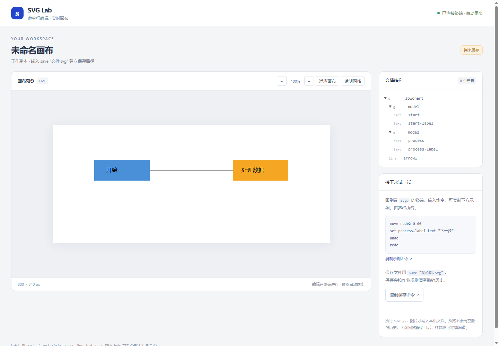

# Lab1 SVG 编辑器

用终端命令画 SVG，同时在浏览器中实时看图。TypeScript + 面向对象，使用 Command 管理撤销重做、Composite 统一叶子与容器操作。

仓库：https://github.com/SharkerSwag/lab1-svg-editor

**2026-10-21：作业十九条命令与实用性改进已实现，95 项测试通过。** 另已在真实 Edge 浏览器检查画布更新、缩放、复制命令、保存状态、重连与窄窗口布局。后续阶段的 box 和动态插件不在当前范围。

## 开始使用

需要 Node.js 24 或更新版本。Windows 可以双击工程目录中的 **start-editor.cmd**：首次启动自动安装依赖，然后进入编辑器。

也可以在工程目录的终端运行：

```powershell
npm ci
npm start
```

终端会出现 `svg>`，浏览器打开实时画布。启动时加载流程图的**工作副本**，首次保存需指定自己的文件名。浏览器无法自动打开时，复制终端打印的本机地址即可。



在 `svg>` 后逐行输入，不要复制提示符：

```text
move node2 0 60
set process-label text "处理数据 v2"
undo
redo
save "我的图.svg"
```

右侧节点会下移，文字跟着移动；修改文字后，undo/redo 会撤销、恢复文字。画面随命令自动更新，**预览不会执行 save，不会清空撤销历史**。最后的 save 才将作品写入磁盘。

画布支持适应窗口、放大缩小和透明网格；右侧显示文档树、当前保存状态，并可复制示例或保存命令。关闭浏览器后，终端仍能编辑；终端退出后，预览服务随之关闭。

## 打开文件与标准 CLI

| 用途 | 在普通终端运行 |
| --- | --- |
| 作业原始 CLI，默认无文档 | `npm run cli` |
| 空会话，附实时预览 | `npm run cli -- --preview` |
| 打开已有 SVG 并预览 | `npm run cli -- --file "我的图.svg" --preview` |
| 打开副本，另存自己的作品 | `npm run cli -- --copy "我的图.svg" --preview` |
| 不自动打开浏览器，只打印地址 | 在启动参数后加 `--no-open` |
| 回放 UTF-8 命令文件并退出 | `npm run cli -- --script "命令.txt"` |
| 启动帮助 | `npm run cli -- --help` |

`--file` 保留原路径，无参数 save 会写回该文件。`--copy` 创建无默认路径的工作副本，避免改写示例。`--script` 中每行一条命令，错误后继续处理，任何一行失败时返回非零退出码；脚本内的相对路径以终端当前工作目录为准。

输入 `help` 查看全部十九条作业命令。支持 VT 的交互终端可使用 ↑/↓ 调出历史、Tab 补全命令名；历史仅保留在当前会话中。`TERM=dumb` 使用简易逐行模式并明确提示。脚本输入不显示交互提示符。

## 保存与退出

- `save "我的图.svg"`：保存到指定文件；读入文档后显式导出另一文件，不改变原有默认保存路径。
- `save`：写回 read/`--file` 绑定的路径；init/`--copy` 后第一次成功保存建立默认路径。
- 未保存提示比较实际文档内容；撤销回已保存的内容会恢复“已保存快照”。显式导出副本也代表当前快照已落盘，但仍不改变默认路径。
- 交互终端按 Ctrl+C：有未保存更改时，第一次提醒保存并继续会话；再次 Ctrl+C 放弃更改并退出。输入新命令会重置退出确认。
- EOF（Windows 的 Ctrl+Z 后回车、其他平台的 Ctrl+D）直接退出；有未保存内容会警告。程序不自动写入恢复文件，退出前请执行 save。

成功 init/read/save 或 canvas 修改尺寸按作业规则清空历史并禁止撤销重做，直到下一次编辑；canvas 查询、tree/show/help 和实时预览不影响历史。失败命令不改变文档、关联路径或历史。

## 示例与验证

```powershell
npm run demo
npm run demo:svg
npm run demo:full
npm run typecheck
npm test
```

`demo:svg` 生成 output/flowchart-before.svg 和 output/flowchart.svg，可拖进浏览器直接查看。`demo:full` 回放题目完整会话与案例 A，其中祖孙冲突和保存后 undo 是题目预期的两条错误。output/ 是生成目录，不提交 Git。

项目 .npmrc 使用 npm 官方源，完整依赖树固定在 package-lock.json。应用运行不需要 Java，PlantUML 图已生成。实时预览只监听本机回环地址，不依赖外部网页、CDN 或新增 npm 包。

SVG 支持范围与限制见 [作业文档](doc/README.md)；本程序实现本阶段的基本 SVG 子集。

## 作业材料

- [架构方案、真实过程、自查与质量保证](doc/README.md)
- [十分钟动手验收：十九条命令与架构阅读路线](doc/动手验收.md)
- [功能验收清单](doc/验收清单.md)
- [验证记录](doc/verification.md)
- [前次独立审查与修复](doc/review-2026-10-19.md)

课程截止为 **2026-10-31 23:59**，须推送最终代码和 final 标签，并将含仓库地址的 doc/README.md 以文件名 README.md 上传课程平台。平台可访问到 11 月 30 日不代表延期。

已有 final 是过早标记的旧版本，暂保留作对照；当前可用版本在 main。最终标签确认和课程平台上传仍待完成。
