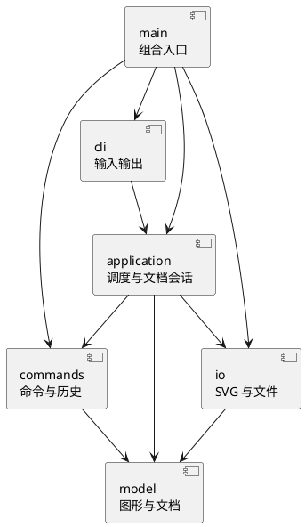

# Lab1：SVG 编辑器（CLI）

仓库地址：https://github.com/SharkerSwag/lab1-svg-editor

状态：2026-10-19 已有 CLI 工程骨架和图形领域模型，正在接入创建与查询命令，尚未完成。文中的“计划”不代表已经实现。

## 架构方案

### 模块划分

| 模块 | 职责 | 当前进度 |
| --- | --- | --- |
| `src/cli/` | REPL、双引号参数解析、提示符和统一错误输出 | 已有骨架 |
| `src/application/` | 命令注册与调度；后续维护当前文档及 IO/历史协调 | 已有注册与调度 |
| `src/commands/` | 对象化命令；后续补齐可撤销编辑命令和历史管理 | 当前只有 `help` |
| `src/model/` | 图形类层次、分组、画布、id 与树结构不变量 | 六种图形、工厂与文档已实现；移动等操作待后续完成 |
| `src/io/` | SVG 解析、序列化及文件读写 | 计划，尚未创建 |
| `src/main.ts` | 组合入口，构造对象并注入依赖 | 已有骨架 |
| `tests/` | 自动测试，包括边界与脚本回放 | 当前覆盖输入与 CLI |

组件图包含计划中的模块；以表中进度区分实际落地情况：

### 设计模式的选择

1. **Command（作业要求）**：当前 `Command` 接口、`HelpCommand` 和 `CommandRegistry` 已将命令对象化。后续新增可撤销编辑命令接口及历史管理器，每条成功编辑作为一个历史单元；当前尚未完成作业要求的编辑撤销机制。复杂树操作先完整验证再执行，并保存恢复父容器、位置与子树所需的信息。
2. **Composite（部分落地）**：抽象 `Shape` 与六种具体类统一几何描述、子节点访问与复制；`Group` 递归复制子树并拒绝形成循环。移动、缩放、属性修改后续补齐。文档维护唯一 id 与树结构，CLI 不通过图形类型分支直接修改几何字段。
3. **集中式工厂**：只在 `ShapeFactory` 中按图形类型名字创建具体类。阶段一不搭建插件加载系统。

仅允许两处按名字分派：`CommandRegistry` 的命令名查找、`ShapeFactory` 图形类型查找。按作业约定将两处列为**待重构点**：后续插件化阶段采用注册机制与提供者接口；注册表已将命令名查找集中，仍保留此项供后续审查。

### 依赖方向规则

- `cli → application`：输入层提交参数，不直接操作图形或文件。
- `application → commands/model/io`：调度命令并协调当前文档、历史与文件操作。
- `commands → model`：编辑行为操作领域对象，不导入 CLI 或文件系统。
- `io → model`：在 SVG 和领域模型之间转换，不控制历史。
- `model` 不依赖以上模块，不导入终端与文件 IO。
- `main.ts` 是组合入口，允许导入各模块来注入对象，不承载图形业务逻辑。
- 测试可以依赖被测模块，不被产品代码反向导入。

不变量由类封装维护；一类一文件。禁止公共数据袋加过程式图形处理，禁止在各层重复 `switch(tag)`。

### 变化点假设

| 变化点 | 当前决策 |
| --- | --- |
| 新增 GUI 或 agent 输入通道 | CLI 与应用层分离，复用命令和图形模型 |
| 新增图形类型及后续 `box` 插件 | 计划统一 Shape 接口和集中工厂；不提前实现动态插件加载 |
| 新增编辑命令 | 用命令对象注册到单一分发入口，避免 REPL 膨胀 |
| 读写格式、外部 SVG 兼容范围 | 独立 `io` 模块，先定义可支持范围，再做往返测试 |
| 大文档导致撤销内存压力 | 先按操作保存必要恢复信息；没有性能证据前不加入磁盘历史 |

尚需确定并记录的规格边界：跨父容器分组的落点与相对顺序、外部 SVG 的 `transform` 支持范围、未知标签和其他属性的处理。实现前查补充说明；缺少明确规则时说明决定与理由，不能静默丢弃后宣称完整支持。

## 过程记录

### 2026-10-19：澄清提交与首个里程碑

- 初次分析只看到附件，不能据此断言老师指定每人创建独立仓库。用户指出这一点后重新检查原文，没有进行 Git 写操作。
- 用户补充课程平台截图：个人 Lab，上传一份包含仓库地址的 README.md，截止显示为 10 月 31 日 23:59。随后用户自行创建并提供公开仓库地址，确定采用独立仓库。
- 初次 Git 访问失败，实测直连失败而使用 Windows 当前代理成功。用户要求长期修复后设置用户级 GitHub 专属代理，并保留配置备份与维护脚本；这些本机配置不进入项目仓库。
- 首次开发范围限定为可运行 CLI、带引号参数解析、错误后继续处理及架构初稿。尚未实现的图形和历史能力明确标记为待办，不把框架代码宣称为作业完成。
- 解析规则按“整行以 # 开始为注释”实现，避免将颜色 `#ffffff` 截断；记录该决策并用测试验证。

后续按真实开发追加：AI 提议、发现的问题、验证方法、实际修改与关联提交。不补造未发生的讨论或测试结果。

### 2026-10-19：六种图形与文档所有权

- 用户本机运行 `help` 成功后，继续实现画布、六种图形及创建查询链路；为保证创建符合“编辑命令可撤销”，同一里程碑计划接入创建的 undo/redo。
- 领域模型接收图形时复制并取得所有权，读取也返回副本，避免外部持有 Group 后直接插入子节点，绕过文档的全局 id 索引。测试分别修改传入对象、查询结果和根列表结果，文档均不变。
- 插入前检查整个子树的重复 id、目标容器存在性与容器能力，验证失败不保留节点或占用 id。数值校验拒绝 NaN、Infinity、十六进制和单位字符串，允许浮点、科学计数法与零尺寸图形；画布尺寸要求为正。
- 模型步骤单独运行测试，19/19 通过（原 10 项加 9 项模型测试），再提交模型，以保留实际开发顺序。

## 一致性自查

1. **模块划分**：当前已创建 cli/application/commands/model，与方案方向一致；io 尚未进入本里程碑，表格明确记录。
2. **依赖方向**：model 只依赖同模块，cli 依赖 application，application 依赖 commands 中的接口，命令不依赖 CLI 或 IO。main 为组合入口。最终需结合实际 import 再做完整审查。

## 质量保证手段

当前提供 `npm run typecheck` 与 `npm test`，后者先构建再用 Node 内置测试运行器执行测试。用例覆盖双引号及中文文字、空文字、路径、颜色、整行注释、未闭合引号、重名命令注册、错误后继续读取和提示符。

2026-10-19 首次骨架实测：`npm install` 成功，`npm test` 构建成功且 10/10 个测试通过；`'help' | npm run cli` 可启动、显示当前里程碑及命令规划，并在 EOF 退出。这里验证的是骨架，不代表图形编辑功能已验收。

后续需要：模型及树不变量测试、每条编辑的 execute/undo/redo 测试、失败后文档及历史均不变、文件 IO 屏障、SVG 缺失 id 和转义测试、保存读取往返、作业示例脚本回放以及浏览器渲染检查。

最终功能验收与证据位置见[验收清单](验收清单.md)。当前尚未完成这些检查，不作为最终质量声明。
