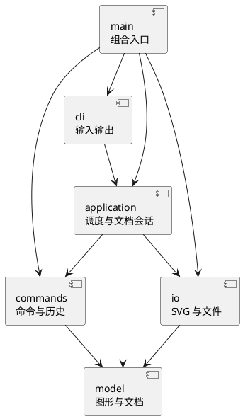

# Lab1：SVG 编辑器（CLI）

仓库地址：https://github.com/SharkerSwag/lab1-svg-editor

状态：2026-10-19 Phase 1 全部 CLI 命令已实现，正在进行最终完整验收。后续 box 插件不在当前实现范围。

## 架构方案

### 模块划分

| 模块 | 职责 | 当前进度 |
| --- | --- | --- |
| `src/cli/` | REPL、双引号参数解析、提示符和统一错误输出 | 已有骨架 |
| `src/application/` | 命令注册与调度、当前文档及历史协调 | 已有 EditorSession；IO 协调待后续实现 |
| `src/commands/` | 对象化命令、可撤销编辑和历史管理 | 十九个 CLI 命令、全部编辑对象与 History 已实现 |
| `src/model/` | 图形类层次、分组、画布、id 与树结构不变量 | 六种图形、工厂、文档、不可变几何与属性变换已实现 |
| `src/io/` | SVG 解析、序列化及文件读写 | XML 解析、序列化、保存与读取均已实现 |
| `src/main.ts` | 组合入口，构造对象并注入依赖 | 已有骨架 |
| `tests/` | 自动测试，包括边界与脚本回放 | 当前覆盖输入、模型、创建、历史和示例回放 |

组件图包含计划中的模块；以表中进度区分实际落地情况：

### 设计模式的选择

1. **Command（作业要求，已在创建链路落地）**：CLI 命令通过 `Command` 和 `CommandRegistry` 执行。`CreateCommand` 为每次输入创建独立的 `CreateShapeEdit`，后者实现 `UndoableEdit.execute/undo`。`History` 只在操作成功后移动栈项，新编辑成功后才清空 redo。`EditorSession` 在成功新建文档和修改尺寸后设置历史屏障。创建编辑保存独立图形副本与父 id；其他编辑命令后续补齐。
2. **Composite**：抽象 `Shape` 与六种具体类统一几何描述、复制、移动、缩放和属性修改；`Group` 递归处理子节点并拒绝形成循环。修改方法返回新对象，原对象保持不变。g 的公共样式设置在容器自身，按 SVG 规则由缺省子节点继承，显式子样式保留。文档维护唯一 id 与树结构，CLI 不按图形类型分支修改几何字段。
3. **集中式工厂**：只在 `ShapeFactory` 中按图形类型名字创建具体类。阶段一不搭建插件加载系统。

仅允许两处按名字分派：`CommandRegistry` 的命令名查找、`ShapeFactory` 图形类型查找。按作业约定将两处列为**待重构点**：后续插件化阶段采用注册机制与提供者接口；注册表已将命令名查找集中，仍保留此项供后续审查。

### 依赖方向规则

- `cli → application`：输入层提交参数，不直接操作图形或文件。
- `application → commands/model/io`：调度命令并协调当前文档、历史与文件操作。
- `commands → model`：编辑行为操作领域对象，不导入 CLI 或文件系统。
- 应用层 `EditorSession` 实现命令层定义的 `CommandContext` 接口；命令通过该接口访问会话能力，不反向导入 application 实现，避免循环依赖。
- `io → model`：在 SVG 和领域模型之间转换，不控制历史。
- `model/DocumentStorage` 定义持久化端口，io 实现、application 注入使用，commands 不导入文件 IO 实现。
- `model` 不依赖以上模块，不导入终端与文件 IO。
- `main.ts` 是组合入口，允许导入各模块来注入对象，不承载图形业务逻辑。
- 测试可以依赖被测模块，不被产品代码反向导入。

不变量由类封装维护；一类一文件。禁止公共数据袋加过程式图形处理，禁止在各层重复 `switch(tag)`。

### 变化点假设

| 变化点 | 当前决策 |
| --- | --- |
| 新增 GUI 或 agent 输入通道 | CLI 与应用层分离，复用命令和图形模型 |
| 新增图形类型及后续 `box` 插件 | 计划统一 Shape 接口和集中工厂；不提前实现动态插件加载 |
| 新增编辑命令 | 用命令对象注册到单一分发入口，避免 REPL 膨胀 |
| 读写格式、外部 SVG 兼容范围 | 独立 `io` 模块，先定义可支持范围，再做往返测试 |
| 大文档导致撤销内存压力 | 先按操作保存必要恢复信息；没有性能证据前不加入磁盘历史 |

修订：创建命令仍保存独立图形副本和父 id；后续基本编辑与结构编辑采用 `SnapshotEdit` 的前后文档快照（Memento）。操作先在独立候选文档上完成，再发布，便于完整保证跨子树操作失败不改变状态、撤销精确还原顺序。代价是每条编辑保存整份文档，适用于本 Lab 的小型示例；尚未针对大型图形做性能保证，不提前加入复杂增量恢复或磁盘历史。

尚需确定并记录的规格边界：跨父容器分组的落点与相对顺序、外部 SVG 的 `transform` 支持范围、未知标签和其他属性的处理。实现前查补充说明；缺少明确规则时说明决定与理由，不能静默丢弃后宣称完整支持。

结构编辑决定：group 至少两个目标，拒绝重复目标和祖孙同时入选；按原文档前序而非参数顺序排列孩子。同父节点分组插在最早入选位置；跨父节点选择最低公共父容器，在最早相关直接分支前插入，不删除原来的空父容器。所有几何使用同一画布坐标，重组不改坐标。ungroup 严格遵守题目的根级禁止规则；front 为同级列表末尾（后绘制、上层），back 为列表开头。普通 g 的样式按 SVG 继承，改变父容器可能改变继承外观，操作不自动重写子样式。

SVG 导入范围：UTF-8 XML、SVG 命名空间或无命名空间、六种基本图形、嵌套、公共样式、数字/px 长度、文字与 CDATA。title/desc/metadata 不作为图形；保留 font-size/font-family/font-weight/font-style/text-anchor/xml:space 作为导入显示属性，不扩展 set 白名单。根尺寸缺失时优先采用 viewBox，否则默认 800×600；存在 viewBox 时要求为 0 0 width height。支持嵌套 translate 并展平至几何坐标；其他 transform、CSS style/class、未支持元素/属性、非 UTF-8 和 DTD 明确拒绝，不静默丢弃。未知 data-kind 警告后降级普通类型，不恢复 box 便利属性。显式 id 先全量预留再补缺失 id，避免与后面元素碰撞。

## 过程记录

### 2026-10-19：澄清提交与首个里程碑

- 初次分析只看到附件，不能据此断言老师指定每人创建独立仓库。用户指出这一点后重新检查原文，没有进行 Git 写操作。
- 用户补充课程平台截图：个人 Lab，上传一份包含仓库地址的 README.md，截止显示为 10 月 31 日 23:59。随后用户自行创建并提供公开仓库地址，确定采用独立仓库。
- 初次 Git 访问失败，实测直连失败而使用 Windows 当前代理成功。用户要求长期修复后设置用户级 GitHub 专属代理，并保留配置备份与维护脚本；这些本机配置不进入项目仓库。
- 首次开发范围限定为可运行 CLI、带引号参数解析、错误后继续处理及架构初稿。尚未实现的图形和历史能力明确标记为待办，不把框架代码宣称为作业完成。
- 解析规则按“整行以 # 开始为注释”实现，避免将颜色 `#ffffff` 截断；记录该决策并用测试验证。

后续按真实开发追加：AI 提议、发现的问题、验证方法、实际修改与关联提交。不补造未发生的讨论或测试结果。

### 2026-10-19：六种图形与文档所有权

- 用户本机运行 `help` 成功后，继续实现画布、六种图形及创建查询链路；为保证创建符合“编辑命令可撤销”，同一里程碑计划接入创建的 undo/redo。
- 领域模型接收图形时复制并取得所有权，读取也返回副本，避免外部持有 Group 后直接插入子节点，绕过文档的全局 id 索引。测试分别修改传入对象、查询结果和根列表结果，文档均不变。
- 插入前检查整个子树的重复 id、目标容器存在性与容器能力，验证失败不保留节点或占用 id。数值校验拒绝 NaN、Infinity、十六进制和单位字符串，允许浮点、科学计数法与零尺寸图形；画布尺寸要求为正。
- 模型步骤单独运行测试，19/19 通过（原 10 项加 9 项模型测试），再提交模型，以保留实际开发顺序。

### 2026-10-19：接入创建、显示与历史

- 将“可复用的 CLI 命令入口”和“每次编辑独立的可撤销对象”分开。若直接把一个 CreateCommand 对象反复压栈，后续输入可能覆盖前次撤销数据；现在每次成功创建对应一个新的 CreateShapeEdit。
- 输入参数解析后先创建合法图形，再由文档完整检查 id 和父容器。History 在 execute 成功返回后才压栈并清空 redo；失败的创建、init 或 canvas 不改变已有文档与历史。
- 为避免 commands 依赖 application，引入 CommandContext 接口，由 EditorSession 实现，而不是让具体命令导入会话实现。
- 添加跨模块测试：失败后 redo 保留、canvas 查询不清历史、成功尺寸修改形成屏障、新编辑清 redo、连续五轮完整撤销与重做保持树顺序、题目流程图的嵌套创建步骤通过真实 CLI 回放。
- 当前 30 项自动测试全部通过。示例只覆盖当前已完成的创建、查看和历史，不宣称完成题目含移动与保存的完整会话。

### 2026-10-19：按需求补齐可见输出

- 用户指出只有终端文字难以理解，因此在既定 CLI 范围内优先实现 save；使用浏览器原生 SVG 预览，不新增 GUI 或插件系统。
- 通用序列化器消费 Shape 的几何、样式、文本与子节点，无需新增按 tag 分支。缺省 fill/stroke 保持省略，文字和属性分开转义，并拒绝 XML 不允许的字符。
- 文件保存先在同目录写独占临时文件，再重命名替换；失败清理本次临时文件，保留已有文件。会话只在写入成功后更新关联路径并设置历史屏障。
- 明确路径策略：save 不带参数使用最近成功 read/save 的关联路径，init 清除关联路径。这补齐了题目未明确的首次 save 后默认路径行为。
- 36/36 自动测试通过，类型检查通过。运行 npm run demo:svg 后，由 Microsoft Edge 无头模式实际加载 output/flowchart.svg，检查到两块彩色矩形、中文文字和连线；该输出由程序生成。

### 2026-10-19：基本编辑与失败原子性

- 为保持多态，移动和缩放由具体图形实现几何变化，Group 递归调用同一接口；没有在 CLI 或编辑命令增加按类型分支。
- 发现只靠“逐节点先改再校验”无法处理后续子节点溢出：第一个节点可能已移动，后面的节点才失败。因此使用不可变图形与候选文档快照提交，原文档在整条操作成功前不变。
- 测试使用前一个小圆和后一个坐标为 1e308 的圆，触发后续节点缩放或平移溢出；整个树和已有 redo 均保持不变。
- 44/44 测试通过，新增基本编辑逐条 undo/redo、删除完整子树、全部几何缩放、属性白名单、样式保留与冲突替换测试。

### 2026-10-19：结构编辑与原顺序恢复

- 新增 StructureEditor，把分组、解组、移动归属和同级排序放到领域层；具体 CLI 命令只校验参数并创建可撤销编辑对象。
- group 的“相对顺序”和跨父容器落点未在附件中完全指定，采用上文明确规则，并通过反向参数顺序、跨分支选择、整棵子树与无关根节点分组等用例固定行为。
- 52/52 测试通过；失败的祖孙分组、自引用 addto、根级 ungroup 均保留原文档及 redo。分组/解组多节点操作各只需一次 undo 即精确还原原父容器和顺序。

### 2026-10-19：SVG 读取与类型分派收敛

- 使用 @xmldom/xmldom 0.9.12 负责 XML 语法解析，读取器只遍历节点、检查支持范围与处理 id，不自行按图形类型重建几何逻辑。
- 若直接在读取器新增 switch(tag)，会违反作业的分派位置限制。因此将 CLI 位置参数和 SVG 命名属性分别封装为 ShapeInput 实现，两条路径复用 ShapeFactory 中唯一的类型 switch。
- 明确拒绝无法保持外观的导入形式。仅展平平移，不把 scale 简单转换为坐标缩放，因为那样会遗漏文字字号、描边等渲染效果。
- XML 库默认使用较宽的换行归一化；为保证 XML 1.0 文本往返，显式使用 CR/CRLF 到 LF 的规则，测试覆盖 Unicode、CR 实体、TAB、U+0085 和 U+2028。
- 62/62 测试通过；题目 other.svg、补 id 避碰撞、全部六种图形往返、失败 read 保留路径/历史、首次无需 init 即可 read 均已验证。

## 一致性自查

1. **模块划分**：cli/application/commands/model/io 均已创建，与方案方向一致；各模块未完成功能在表格中明确记录。
2. **依赖方向**：model 只依赖同模块；cli 依赖 application；application 依赖 commands/model；commands 仅依赖同模块和 model，不导入 application/cli 或文件系统；io 实现 model 的存储端口。main 为组合入口。

## 质量保证手段

当前提供 `npm run typecheck` 与 `npm test`，后者先构建再用 Node 内置测试运行器执行测试。用例覆盖双引号及中文文字、空文字、路径、颜色、整行注释、未闭合引号、重名命令注册、错误后继续读取和提示符。

2026-10-19 首次骨架实测：`npm install` 成功，`npm test` 构建成功且 10/10 个测试通过；`'help' | npm run cli` 可启动、显示当前里程碑及命令规划，并在 EOF 退出。这里验证的是骨架，不代表图形编辑功能已验收。

同日创建里程碑：`npm test` 构建成功且 30/30 通过。新增了领域模型、当前命令的失败原子性、创建撤销重做、尺寸屏障和真实 CLI 示例回放测试。各测试文件位于 `tests/`，回放输入位于 `examples/creation.txt`。

后续需要：其余每条编辑的 execute/undo/redo 与失败原子性测试、文件 IO 屏障、SVG 缺失 id 和转义测试、保存读取往返、作业完整示例回放以及浏览器渲染检查。

最终功能验收与证据位置见[验收清单](验收清单.md)。当前尚未完成这些检查，不作为最终质量声明。
