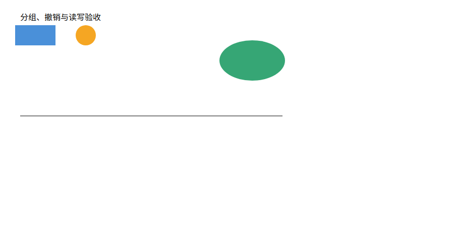

# 十分钟动手验收

这个 Lab 的界面是终端：命令修改内存里的图形树，`save` 才生成可看的 SVG 图片。`tree` 显示结构，浏览器显示图片；普通 `g` 只是把图形放在一起操作，本身没有边框。

2026-10-21 已加入实时看图：先运行 npm ci，再运行 npm start，或在 Windows 双击 start-editor.cmd。终端和浏览器同时打开，示例以工作副本加载。在终端执行 move node2 0 60 就能看到节点移动，undo 可以恢复。保存前预览会显示“尚未保存”；在终端执行 save 才写入磁盘，预览本身不影响撤销历史。下面十九命令流程仍使用原始 CLI，便于逐项核对作业。

## 启动

在工程目录的普通终端运行：

```powershell
npm ci
npm run demo:svg
npm run cli
```

`demo:svg` 会准备 output 目录并生成现有流程图。出现 `svg>` 后，再逐行输入下面的命令，不要复制提示符。此流程会覆盖 output/动手验收.svg，试验图请使用其他文件名。

## 操作与观察

以下流程覆盖本阶段十九条命令。保留三个故意的错误，用来检查程序报错后仍然能继续操作。

```text
help
init 640 360
create g scene
create rect r 40 80 160 80 #4a90d9 in scene
create circle c 320 120 40 #f5a623 in scene
create ellipse e 500 120 65 40 #36a675 in scene
create line l 40 230 560 230 black in scene
create text title 40 40 "我的 SVG 验收图" in scene
create g details in scene
group pair r c
tree
move pair 20 20
show r
undo
show r
redo
scale pair 0.5
set title text "分组、撤销与读写验收"
addto details e
front r
back c
tree pair
ungroup pair
delete details
undo
save "output/动手验收.svg"
undo
read "output/动手验收.svg"
canvas
canvas 800 400
save
create box future 0 0 100 60 "下阶段"
scale r 0
tree
```

检查这些变化：

- 第一次 `tree`：r、c 在 pair 中，pair 在 scene 中。
- 两次 `show r`：移动后 x=60、y=100；undo 后回到 x=40、y=80。redo 再次应用移动。
- `scale pair 0.5`：位置和尺寸都减半；r 最终 x=30、y=50、width=80、height=40。
- `ungroup pair`：r、c 提升到 scene，pair 消失。`delete details` 删除它和 e，紧接的 undo 恢复整个子树。
- 第一次 save 后 undo：出现 `error: undo not allowed after io command`，符合文件命令的历史屏障规定。
- read 后 canvas 显示 640×360；修改后最后 tree 显示 800×400，共七个元素：两个 g 和五个叶子图形。
- `create box` 报 unknown shape type；`scale r 0` 报 scale factor must be positive。这两个失败命令不改变图形。

## 看图片

把工程目录下的 output/动手验收.svg 拖进浏览器，应该看到中文标题、蓝色矩形、橙色圆、绿色椭圆和黑色横线。矩形和圆因整体缩放变小；两个 g 不会画出边框。继续编辑并保存后，在浏览器刷新才能看到新结果。

下面是上述命令实际生成的 SVG 在 Edge 中的截图；对应源文件保存在 doc/hands-on-preview.svg。



## 理解架构并准备说明

可以沿一次 `move pair 20 20` 的调用路径阅读代码：

1. CommandParser 把一行文字分成参数，CommandRegistry 找到 MoveCommand。
2. MoveCommand 创建 MoveEdit，EditorSession 交给 History 执行。
3. MoveEdit 经 SnapshotEdit 在候选文档上编辑，成功才发布；History 保存撤销单元。
4. Shape.moved 调用多态方法；Group 递归移动子节点，Rect/Circle 等修改自己的几何数据。
5. save 经 DocumentStorage 接口进入文件 IO，SvgSerializer 将相同模型写成 SVG。

能解释 Command 为什么支持一条命令一次撤销、Composite 为什么使容器与叶子使用相同命令，以及模型为什么不直接操作文件，就掌握了本作业的核心。完整方案和真实迭代过程见 doc/README.md。

自动测试会在临时目录回放本页命令，检查三个预期错误、最终图形与保存后的尺寸；浏览器外观仍应由本人实际查看。
